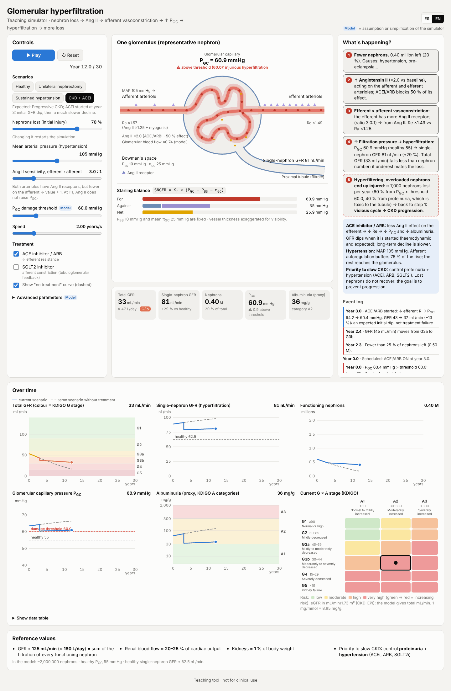

# Hiperfiltración glomerular / Glomerular hyperfiltration — interactive teaching simulator

**Live demo:** https://ferasmed-dev.github.io/simulator-glomerular-of-hyperfiltration/ · English: [`?lang=en`](https://ferasmed-dev.github.io/simulator-glomerular-of-hyperfiltration/?lang=en)

A small, transparent, tunable model of **glomerular hyperfiltration** and the **vicious cycle of chronic kidney disease (CKD) progression**, built for medical students. The interface is available in **Spanish and English** (ES/EN switch, top right).

> ⚠️ **Teaching tool, not for clinical use.** The numbers are chosen to show *directions and mechanisms*, not to predict any patient's course.



## What it shows

1. **Fewer nephrons** (hypertension, pre-eclampsia, CKD…) → **Ang II rises** and acts on the afferent and efferent arterioles.
2. Both arterioles have Ang II receptors, but **fewer on the afferent** → **efferent vasoconstriction predominates**.
3. → **↑ glomerular capillary pressure (P_GC)** → **↑ single-nephron GFR (SNGFR)** in the remaining nephrons = **hyperfiltration**. Total GFR (the sum of every functioning nephron's filtration) falls less than nephron number, so it underestimates the loss.
4. **Hyperfiltering, overloaded nephrons end up injured**, and **albuminuria** (a marker of damage, cardiovascular risk and progression; filtered protein is toxic to the tubule) adds to the injury → more nephron loss → back to step 1 → **vicious cycle → CKD progression**.
5. Lost nephrons do not recover; the goal is to slow progression by controlling **proteinuria + hypertension** (ACE inhibitors, ARBs, SGLT2 inhibitors).

The app has:

- An **animated glomerulus** (afferent → capillary tuft → efferent, Bowman's space, proximal tubule). Vessel width shows constriction (exaggerated so it is visible), Ang II receptor glyphs are denser on the efferent, red dots are blood (speed ∝ glomerular blood flow) and yellow dots are filtrate (rate ∝ SNGFR). A Starling bar shows the forces for and against filtration.
- **Sliders**: % nephrons lost (initial injury), mean arterial pressure (MAP), efferent:afferent Ang II sensitivity ratio, damage threshold, time speed, plus an "advanced" panel for every other tuning constant.
- **Treatment toggles**: ACE inhibitor/ARB and SGLT2 inhibitor. Turning one on mid-run shows the **initial GFR dip** followed by a **slower decline**; a dashed "no treatment" curve shows what would have happened without it.
- **Scenarios**: *Healthy*, *Unilateral nephrectomy*, *Sustained hypertension*, *CKD + ACEi* (ACEi starts automatically at year 3).
- **Live charts** (years on x): total GFR coloured by KDIGO G stage, SNGFR, nephron number, P_GC (with damage threshold) and an albuminuria proxy on KDIGO A1/A2/A3 bands, plus the **KDIGO 2012 G×A prognosis grid** (category names included) with the current cell highlighted. Hover any chart for a synced crosshair; a data table view is available.
- A **"What's happening?" / "¿Qué está pasando?"** panel that lights up each step of the vicious cycle as it happens, with an event log (stage changes, threshold crossings, the "sentinel" rise of albuminuria before GFR falls, treatment starts with the size of the dip). Switching language re-renders everything, including the log.

The **Model** tag marks values that are tuning choices or simplifications of the simulator rather than physiology.

## The model (`src/model.js`)

Pure functions, no DOM. State variable: **N**, the number of functioning nephrons (both kidneys). Units: mmHg, nL/min (SNGFR), mL/min (GFR), years.

**1. Ang II rises as nephrons are lost.** With nephron deficit `d = 1 − N/N₀`:

```
A = 1 + g · d / (1 − d + 0.2)          (A = 1 is basal Ang II; g = angGain)
```

**2. Afferent and efferent resistances.** Ang II constricts both, but the efferent `ρ` times more (`ρ` = Re:Ra sensitivity ratio, a slider). ACEi/ARB remove a fraction `b` of the Ang II effect; SGLT2i adds afferent tone (tubuloglomerular feedback):

```
A_eff = A · (1 − b·[ACEi/ARB])
Re    = Re₀/(1 + s) · (1 + s·A_eff)
Ra*   = 1/(1 + s/ρ) · (1 + (s/ρ)·A_eff) · (1 + k_SGLT2·[SGLT2i])
```

The structural parts are scaled so the healthy state is identical whatever `ρ` is. With `ρ = 1` (equal constriction) Ang II does **not** raise P_GC — a useful teaching check.

**3. Afferent myogenic autoregulation.** Inside the autoregulatory range (80–180 mmHg) the glomerulus only "sees" a fraction `(1 − a)` of a MAP change; outside it, changes are transmitted fully:

```
MAP_eff = 93 + (1 − a)·(clamp(MAP, 80, 180) − 93) + (MAP − clamp(MAP, 80, 180))
Ra      = (MAP − P_out)/(MAP_eff − P_out) · (Ra* + Re) − Re
```

**4. Series-resistor (voltage-divider) glomerular pressure:**

```
P_GC = P_out + (MAP − P_out) · Re / (Ra + Re)
```

Efferent constriction ↑ P_GC; afferent constriction ↓ P_GC.

**5. Starling filtration per nephron:**

```
SNGFR = Kf · max(0, P_GC − P_BS − π_GC)          GFR = N · SNGFR
```

`Kf` is calibrated so that the healthy state gives SNGFR = 62.5 nL/min and GFR = 125 mL/min.

**6. Albuminuria proxy** (exponential in P_GC, mapped to KDIGO A1 < 30, A2 30–300, A3 > 300 mg/g):

```
ACR = 10 · exp((P_GC − 55) / 4.55)               (P_GC 60 mmHg ↔ 30 mg/g)
```

**7. Nephron loss — three causes (explicit Euler, Δt = 0.05 y ≈ 18 days):**

```
dN/dt = −N · ( k_age                                      baseline (age)
             + k_hemo · max(0, P_GC − threshold)          sustained hyperfiltration
             + k_prot · max(0, ln(ACR / 30)) )            proteinuria (tubular toxicity), from A2
```

With the default threshold of 60 mmHg the two injury terms switch on together (ACR = 30 mg/g at P_GC = 60 mmHg); moving the threshold slider separates them.

**8. KDIGO G stages:** G1 ≥ 90, G2 60–89, G3a 45–59, G3b 30–44, G4 15–29, G5 < 15. KDIGO defines these in mL/min/1.73 m² (eGFR by CKD-EPI); the model outputs total mL/min.

### Parameters

| Parameter | Value | Basis |
|---|---|---|
| Healthy GFR | 125 mL/min (≈ 180 L/day) | Physiology |
| Renal blood flow, kidney mass | ≈ 20–25 % of cardiac output; ≈ 1 % of body weight | Physiology (displayed, not used in equations) |
| Ang II receptors on both arterioles, fewer on afferent | qualitative | Physiology. Ratio magnitude (default 3:1) is an assumption |
| ACEi/ARB, SGLT2i to slow CKD; KDIGO G/A categories | — | KDIGO 2012/2024 |
| N₀ (both kidneys) | 2 000 000 | Commonly quoted figure; real counts vary widely, ~0.2–2.7 million per kidney (Bertram et al., 2011) |
| P_BS | 10 mmHg | Teaching value |
| π_GC (mean) | 25 mmHg | Teaching value |
| MAP default | 93 mmHg | Normal adult |
| Healthy P_GC | 55 mmHg | Textbooks give ~50–60 mmHg (Guyton & Hall quote 60 with different P_BS/π) |
| Kf | 3.125 nL/min/mmHg per nephron | Derived: 62.5 / (55 − 10 − 25) |
| P_out (post-efferent pressure) | 0 mmHg | Simplification |
| Ang II gain `g` | 1.5 | Tuning assumption |
| Efferent Ang II sensitivity `s` | 1.0 | Tuning assumption |
| Autoregulation `a`, range | 75 %, 80–180 mmHg | Range: Guyton & Hall; fraction is a tuning assumption |
| Damage threshold | 60 mmHg | Tuning assumption (slider) |
| k_hemo | 0.012 /year per mmHg above threshold | Tuning assumption |
| k_prot | 0.036 /year per e-fold of ACR above 30 mg/g | Tuning assumption |
| k_age | 0.005 /year | Tuning assumption (≈ 0.6 mL/min/year healthy decline) |
| ACEi/ARB block `b` | 50 % of the Ang II effect | Tuning assumption → acute GFR dip ≈ 10–20 %, within the ≤ 30 % usually accepted (Bakris & Weir, 2000) |
| SGLT2i afferent effect | +10 % Ra | Mechanism: Cherney et al., 2014; size is an assumption |
| Albuminuria proxy | 10 mg/g at 55 mmHg, e-fold per 4.55 mmHg | Tuning assumption |

### Known simplifications

- One "representative" nephron; all surviving nephrons behave the same.
- π_GC is a fixed mean (in reality it rises along the capillary and with filtration fraction); Kf is constant (in reality it changes with hypertrophy and sclerosis).
- Nephron hypertrophy and plasma-flow-driven hyperfiltration are not modelled; only the Ang II/efferent mechanism is.
- ACEi/ARB do not lower MAP here (in patients they usually do) — move the MAP slider yourself to combine both effects.
- The albuminuria proxy depends only on P_GC.

### Scenarios and what they should do

| Scenario | Settings | Expected (checked by `tests/model.test.js`) |
|---|---|---|
| Healthy / Sano | 0 % loss, MAP 93 | GFR 125 → ~113 mL/min over 30 y (age only); G1/A1 throughout |
| Unilateral nephrectomy | 50 % loss | GFR ≈ 76 mL/min, SNGFR +21 %, P_GC 59 mmHg (below threshold) → no vicious cycle; still G2 at 30 y |
| Sustained hypertension | 25 % loss, MAP 115 | P_GC just above threshold, A2 from the start ("sentinel") → decline that accelerates (2nd decade > 1st); G4 by 30 y |
| CKD + ACEi | 70 % loss, MAP 105, ACEi from year 3 | Progressive CKD; at year 3 GFR dips 43 → 37 mL/min, then ~0.5 mL/min/y vs ~2.8 mL/min/y untreated over the next decade |

## Repository layout

```
index.html           page markup (text filled in from i18n.js)
src/model.js         physiology — pure functions, scenarios
src/i18n.js          Spanish and English strings
src/ui.js            DOM, animation loop, explanations, language switch
src/charts.js        tiny dependency-free SVG charts + KDIGO grid
src/styles.css       styles (light/dark)
tests/model.test.js  unit tests (Node's built-in test runner)
docs/screenshot.png  screenshot used above
.github/workflows/   runs the tests on every push
```

No build step, no dependencies, no CDN: everything is plain ES modules.

### Language

The language is chosen from `?lang=es|en` in the URL, then the last choice (saved in the browser), then the browser language. To add a language, copy one of the dictionaries in `src/i18n.js`, translate it, and add it to `DICT` and `LANGS` plus a button in `index.html`.

## Run locally

ES modules need to be served over HTTP (opening `index.html` directly as a file won't load them):

```bash
python3 -m http.server 8000      # or: npx serve .
# open http://localhost:8000
```

Run the tests (Node ≥ 18):

```bash
node --test        # or: npm test
```

## Deploy to GitHub Pages

```bash
cd hiperfiltracion-glomerular
git init -b main
git add .
git commit -m "Glomerular hyperfiltration teaching simulator"
git remote add origin https://github.com/ferasmed-dev/hiperfiltracion-glomerular.git
git push -u origin main
```

(Create the empty public repository on github.com first, without a README or licence.) Then on GitHub: **Settings → Pages → Build and deployment → Source: "Deploy from a branch" → Branch: main, folder: / (root) → Save**. After a minute or two the site is live at `https://ferasmed-dev.github.io/hiperfiltracion-glomerular/`. The empty `.nojekyll` file tells Pages to serve the files as they are.

## References

- Brenner BM, Meyer TW, Hostetter TH. Dietary protein intake and the progressive nature of kidney disease: the role of hemodynamically mediated glomerular injury… *N Engl J Med* 1982;307:652–659 (hyperfiltration hypothesis).
- Hall JE, Hall ME. *Guyton and Hall Textbook of Medical Physiology*, glomerular filtration and autoregulation chapters.
- KDIGO 2012 Clinical Practice Guideline for the Evaluation and Management of CKD. *Kidney Int Suppl* 2013;3:1–150; KDIGO 2024 update, *Kidney Int* 2024;105(4S):S117–S314.
- Bakris GL, Weir MR. ACE inhibitor–associated elevations in serum creatinine: is this a cause for concern? *Arch Intern Med* 2000;160:685–693.
- Cherney DZI et al. Renal hemodynamic effect of SGLT2 inhibition in patients with type 1 diabetes. *Circulation* 2014;129:587–597.
- Bertram JF et al. Human nephron number: implications for health and disease. *Pediatr Nephrol* 2011;26:1529–1533.

## Licence

MIT — see [LICENSE](LICENSE).
